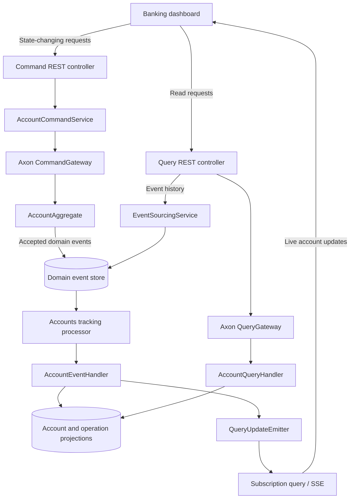
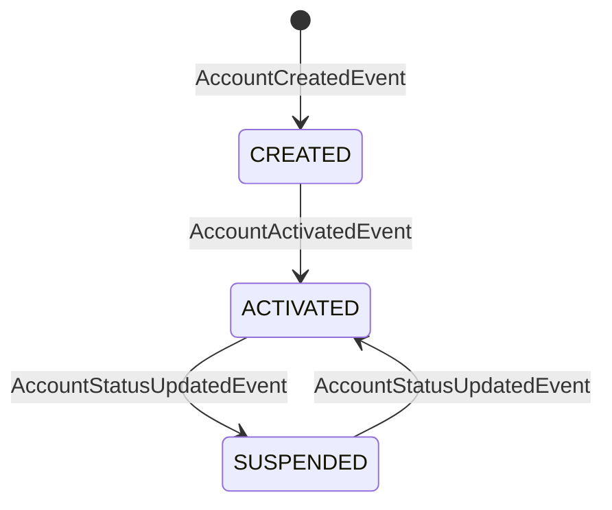

# Event-Sourced Banking — CQRS with Spring Boot and Axon

## Project overview

We developed a banking application that demonstrates **Command Query Responsibility Segregation (CQRS)** and **Event Sourcing** using Spring Boot and Axon Framework.

The project manages account creation, credits, debits, suspension, and reactivation. Accepted changes become domain events, from which account state and separate query models are reconstructed. A browser dashboard displays balances, statements, and event history with live updates through subscription queries and Server-Sent Events.

**Repository:** [Souhaib0101/eventsrc-cqrs-axos](https://github.com/Souhaib0101/eventsrc-cqrs-axos)

## Table of contents

- [Project objectives](#project-objectives)
- [Technologies used](#technologies-used)
- [Technical concepts](#technical-concepts)
- [Application architecture](#application-architecture)
- [Implementation stages](#implementation-stages)
- [Domain model and business rules](#domain-model-and-business-rules)
- [Persistence and read models](#persistence-and-read-models)
- [Example of the implemented event flow](#example-of-the-implemented-event-flow)
- [Live updates and frontend design](#live-updates-and-frontend-design)
- [Validation and error handling](#validation-and-error-handling)
- [Testing strategy](#testing-strategy)
- [Project organization](#project-organization)
- [Technical outcomes](#technical-outcomes)
- [Author](#author)

## Project objectives

We built a banking domain in which every balance change could be explained through its recorded history. Our goals were to:

- Separate state-changing operations from data retrieval.
- Enforce business rules through commands and an event-sourced aggregate.
- Persist domain events and build query-oriented relational projections.
- Demonstrate eventual consistency, replay, and live interface updates.
- Verify domain behavior and application integration with automated tests.

## Technologies used

| Technology | Role in the project |
|---|---|
| **Java 21** | Target language level; records for messages/DTOs, `BigDecimal` for money, and `Instant` for timestamps |
| **Spring Boot 3.4.3** | Application bootstrap, dependency injection, configuration, and component integration |
| **Axon Framework 4.10.3** | Command dispatching, event-sourced aggregates, event storage, event processing, queries, and subscription queries |
| **Spring Web MVC** | HTTP controllers for the command side, query side, event history, and SSE delivery |
| **Spring Data JPA / Hibernate** | Relational persistence of account and operation projections; JPA-backed event storage in embedded mode |
| **H2** | Persistent local storage for the default application mode and in-memory storage for integration tests |
| **PostgreSQL 16** | Optional relational backend for projection/token storage and the embedded event store |
| **Axon Server 2024.1.4** | Optional external domain-event storage and Axon messaging infrastructure |
| **Jackson, Jakarta Bean Validation, Lombok 1.18.38** | Serialization, request validation, and model boilerplate reduction |
| **Project Reactor, SSE / EventSource** | Reactive account-update streams and live browser delivery |
| **HTML, CSS, JavaScript** | Dashboard structure, presentation, command forms, statements, and event-history rendering |
| **Maven** | Dependency management, compilation, packaging, and test execution |
| **Docker Compose** | Definition of optional Axon Server and PostgreSQL infrastructure with persistent volumes |
| **JUnit 5 and Axon Test** | Aggregate behavior tests using command/event scenarios |
| **MockMvc, AssertJ, Awaitility, Reactor Test** | HTTP integration assertions, asynchronous projection checks, and subscription-stream verification |

## Technical concepts

### 1. CQRS: separating commands from queries

CQRS separates two responsibilities:

- **Commands** express an intention to change state, such as crediting an account.
- **Queries** retrieve information without changing the domain state, such as reading an account statement.

We implemented separate command and query controllers, message types, and handlers. The command side uses an aggregate designed around business rules. The query side uses relational models designed around account details and operation history.

This is a logical separation within one Spring Boot application. Separate services or separate database servers are not required to implement the pattern.

### 2. Event Sourcing: storing changes as facts

In Event Sourcing, the account's event stream is the write-side source of truth. Its current state can be reconstructed by applying the recorded events in sequence.

Opening balances, credits, and debits are retained as distinct facts. Rejected commands do not generate domain events.

### 3. Commands and domain events

A command describes **what should happen**; an event describes **what happened**.

| Command | Events produced when accepted |
|---|---|
| `CreateAccountCommand` | `AccountCreatedEvent`, followed by `AccountActivatedEvent` |
| `CreditAccountCommand` | `AccountCreditedEvent` |
| `DebitAccountCommand` | `AccountDebitedEvent` |
| `UpdateAccountStatusCommand` | `AccountStatusUpdatedEvent`, when the requested status differs from the current status |

We used Java records for these messages so their payloads have explicit, immutable data structures.

### 4. The aggregate as a consistency boundary

`AccountAggregate` owns the identifier, balance, currency, and status required to validate changes. **Command handlers check invariants and apply events; event-sourcing handlers reconstruct state from those events.**

### 5. Projections and read models

We implemented `BankAccount` and `AccountOperation` as relational projections for querying balances, statuses, and operations without reconstructing the aggregate for each request. These are derived models that can be rebuilt from stored events.

### 6. Eventual consistency

The `accounts` tracking processor consumes events asynchronously, so a command may complete before its updated balance becomes queryable. We accounted for this delay in the dashboard and integration tests.

### 7. Event replay

Replay applies stored events again to reconstruct state. The project demonstrates two forms:

- **Aggregate reconstruction:** Axon restores an account aggregate from its prior events before processing later commands.
- **Projection reconstruction:** the tracking processor reprocesses historical events to rebuild account and operation tables.

Replay rebuilds derived state; it does not represent new business operations or append replacement domain events.

### 8. Subscription queries and SSE

An Axon subscription query provides an initial result and subsequent updates. We connected it to an HTTP SSE response, allowing the browser's `EventSource` to receive account-specific changes without a full page reload.

## Application architecture



### Main responsibilities

| Component | Responsibility |
|---|---|
| `AccountCommandRestController` | Accept validated state-changing requests |
| `AccountCommandService` | Generate account identifiers and dispatch commands |
| `AccountAggregate` | Restore state, enforce invariants, and apply events |
| `AccountEventHandler` | Project events and publish account-query updates |
| `AccountQueryHandler` | Resolve account, operation, and statement queries |
| `AccountQueryRestController` | Expose read models and the live account stream |
| `AccountEventSourcingRestController` | Expose the account's persisted domain-event history |
| `EventSourcingService` | Read event identifiers, sequence numbers, timestamps, types, and payloads from the event store |
| `BankAccountMapper` | Convert projection entities into response DTOs |
| `ApiExceptionHandler` | Translate validation and domain failures into HTTP problem details |

## Implementation stages

We realized the application in nine main stages, progressing from the initial Spring Boot foundation to the live banking dashboard.

### Stage 1 — Establishing the application foundation

We created the Spring Boot application, entry point, Maven configuration, wrapper files, and initial test, establishing the structure for later domain and infrastructure components.

### Stage 2 — Configuring Spring Boot and durable event storage

We configured Spring Web, JPA, Axon, validation, and Jackson serialization. File-backed H2 provided persistent local storage, while the `accounts` processing group used tracking event processing. Tests used a separate in-memory H2 configuration.

### Stage 3 — Defining commands and domain events

We modeled four command types, five domain-event types, account/operation enums, and the insufficient-balance exception. This separated requested actions from accepted facts in the domain vocabulary.

### Stage 4 — Implementing the event-sourced aggregate

We implemented `AccountAggregate` with an identifier, command handlers, and event-sourcing handlers. It validated amounts, currency, funds, and status before applying events; creation also emitted an activation event.

Axon fixture tests expressed behavior through prior events, a command, and expected events or failures.

### Stage 5 — Exposing commands and event history

We implemented validated command endpoints under `/commands/accounts`, a service backed by `CommandGateway`, and UUID generation for new accounts. An event-history service read aggregate streams from `EventStore`, while centralized handling translated failures into `ProblemDetail` responses.

### Stage 6 — Building query projections and statements

We introduced projection entities, repositories, DTOs, and a mapper. `AccountEventHandler` updated relational state, and `AccountQueryHandler` resolved account, operation, and statement queries under `/query/accounts`. Integration tests covered the command-to-event-to-projection flow.

### Stage 7 — Adding live updates and projection replay

We connected account-specific subscription queries to SSE through `QueryUpdateEmitter`, including subscription cleanup. A projection reset handler enabled replay, with tests covering reconstruction, preserved operation history, and account-specific updates.

### Stage 8 — Defining alternative runtime infrastructure

We added Axon Server and PostgreSQL profiles plus Docker Compose services with persistent volumes. These supported external event storage, an alternative relational database, or both, without changing the domain model.

### Stage 9 — Developing the banking dashboard

We built a Spring Boot-served HTML/CSS/JavaScript dashboard for account commands, balances, statements, and event history. `EventSource` connected live updates, while polling handled newly created projections becoming available asynchronously.

## Domain model and business rules

### Account state

The aggregate tracks `accountId`, a `BigDecimal` balance, currency, and a status of `CREATED`, `ACTIVATED`, or `SUSPENDED`. The account projection also stores its creation timestamp.

### Monetary invariants

We enforced the following rules:

- Initial balances must be non-negative.
- Credit and debit amounts must be strictly positive.
- Monetary values allow at most **17 integer digits and 2 decimal places**.
- A resulting balance cannot exceed `99999999999999999.99`.
- A debit cannot exceed the available balance.
- Currency inputs follow a three-uppercase-letter format; creation also validates the code using Java's `Currency` API.
- The operation currency must match the account currency.

Using `BigDecimal` on the backend avoids binary floating-point arithmetic for domain calculations.

### Account lifecycle



New accounts were automatically activated. Credits and debits were permitted only while an account was `ACTIVATED`.

Subsequent status commands accepted `ACTIVATED` or `SUSPENDED`. Returning an existing account to `CREATED` was rejected, and repeating its current status did not generate a redundant event.

## Persistence and read models

### Event-store responsibilities

The event store preserved payloads, identifiers, per-account sequence numbers, and UTC timestamps represented by Java `Instant`. `EventSourcingService` exposed this history independently of the operation projection.

### Relational projections

| Model | Main information |
|---|---|
| `BankAccount` | Account ID, projected balance, currency, status, and creation timestamp |
| `AccountOperation` | Event-based operation ID, account relationship, amount, currency, credit/debit type, timestamp, and sequence number |

Statements combined the account and its operations in sequence order. Initial funding belonged to the creation event, not a separate credit operation.

### Persistence arrangements

| Configuration | Domain-event storage | Projection and token storage |
|---|---|---|
| Default local mode | Embedded, file-backed H2 | H2 |
| Axon Server profile | Axon Server | Separate local H2 database |
| PostgreSQL profile | Embedded, PostgreSQL | PostgreSQL |
| Axon Server and PostgreSQL | Axon Server | PostgreSQL |

Local mode kept event and projection tables in the same relational database while retaining their different responsibilities. Axon Server mode moved domain-event storage outside the application database.

Tracking tokens persisted the processor's progress. Switching between storage configurations did not itself migrate event history.

### Projection rebuild behavior

The `@ResetHandler` cleared the operation and account projections before replay. The tracking processor then rebuilt them from the existing event stream.

Operation identifiers were derived from event identifiers, and operation timestamps came from the original events. Rebuilding therefore preserved the relationship between projected operations and their source facts.

Replay-generated notifications were suppressed with `ReplayToken.isReplay(...)`, avoiding a flood of historical changes to live clients. Projection reset/replay was demonstrated through application integration tests rather than a public REST endpoint.

## Example of the implemented event flow

The following scenario illustrates the relationship between commands, events, aggregate state, and projections:

| Step | Accepted command | Recorded event | Balance after applying the event |
|---:|---|---|---:|
| 1 | Create an account with 100.00 MAD | `AccountCreatedEvent`, sequence 0 | 100.00 MAD |
| 2 | Continuation of account creation | `AccountActivatedEvent`, sequence 1 | 100.00 MAD |
| 3 | Credit 50.25 MAD | `AccountCreditedEvent`, sequence 2 | 150.25 MAD |
| 4 | Debit 20.10 MAD | `AccountDebitedEvent`, sequence 3 | 130.15 MAD |

This produced four domain events, two projected operations, and a balance of **130.15 MAD**. The same history could reconstruct the aggregate or rebuild the projections.

An invalid debit, mismatched currency, or operation on a suspended account was rejected before a new event was appended.

## Live updates and frontend design

The dashboard was implemented as static resources served by the same Spring Boot application. It used HTTP requests for commands and read models, and a persistent SSE connection for selected-account updates.

### Update lifecycle

1. A command was accepted and its events were stored.
2. The tracking processor delivered the events to `AccountEventHandler`.
3. The handler updated the relational projection.
4. `QueryUpdateEmitter` emitted the changed account to matching subscription queries.
5. The browser received an SSE update and reloaded the statement and event history.

Axon's update emitter published notifications after the event-processing unit of work committed. Account identifiers filtered the subscriptions so unrelated account updates were not delivered to the selected account's stream.

The frontend displayed account state, statements, and event payloads; connected forms to commands; and handled polling, reconnection feedback, subscription cleanup, and stale asynchronous responses.

Backend event times were UTC instants; the browser formatted them in the viewer's local time zone.

## Validation and error handling

Validation was implemented at two levels:

1. **HTTP boundary:** Jakarta Bean Validation checked required fields, amount constraints, precision, and currency format in request DTOs.
2. **Domain boundary:** the aggregate checked funds, resulting balance limits, operation currency, account status, and allowed status changes.

This kept business invariants in the domain model even when commands were dispatched outside a REST controller.

`ApiExceptionHandler` mapped errors to structured HTTP problem details:

| Failure category | HTTP representation |
|---|---|
| Invalid input or arguments | `400 Bad Request` |
| Missing aggregate or projected account | `404 Not Found` |
| Insufficient balance or invalid account state for an operation | `409 Conflict` |
| Unrecognized asynchronous failure | `500 Internal Server Error` |

The handler unwrapped asynchronous exceptions to expose meaningful domain errors such as `Insufficient balance`.

## Testing strategy

We implemented tests at the domain and application-integration levels.

### Aggregate behavior tests

`AccountAggregateTests` used `AggregateTestFixture` to model scenarios as:

**Given prior events → When a command is handled → Then expected events, state, or rejection.**

Coverage included creation/activation, state reconstruction, overdrafts, invalid amounts, currency mismatches, suspended-account restrictions, and reactivation.

### Application integration tests

`DemoEsCqrsAxonApplicationTests` integrated Spring Boot, MockMvc, Axon, and in-memory H2 to cover:

- Commands, event history, projected balances, and ordered statements.
- Invalid requests, missing accounts, and suspended-account restrictions.
- Account-specific subscription updates and cancellation cleanup.
- Replay without duplicated operations, preserving identifiers, timestamps, and event history.

Awaitility handled asynchronous projection assertions, and Reactor Test's `StepVerifier` verified the live query stream. The integration-test configuration used an in-memory H2 database with schema creation/removal and Axon Server disabled.

## Project organization

```text
src/main/java/net/montaki/demoescqrsaxon/
|-- DemoEsCqrsAxonApplication.java
|-- commands/
|   |-- aggregates/       # AccountAggregate and its business rules
|   |-- commands/         # State-changing messages
|   |-- controllers/      # Command HTTP boundary
|   |-- dto/              # Validated request records
|   |-- exceptions/       # Domain-specific failures
|   `-- services/         # Command dispatching
|-- enums/                # Account status and operation type
|-- events/               # Accepted domain facts
|-- mappers/              # Projection-to-response conversion
|-- queries/
|   |-- controllers/      # Read models, event history, and SSE
|   |-- dto/              # Query response records
|   |-- entities/         # Relational read models
|   |-- handlers/         # Projection and query handlers
|   |-- queries/          # Read-side messages
|   |-- repository/       # JPA access to projections
|   `-- services/         # Event-store history access
`-- web/                  # Centralized HTTP exception translation

src/main/resources/
|-- application.properties
|-- application-axon-server.properties
|-- application-postgres.properties
`-- static/               # Dashboard HTML, CSS, and JavaScript

src/test/
|-- java/                 # Aggregate and integration scenarios
`-- resources/            # Isolated test persistence configuration
```

This organization separated business decisions, domain messages, projection logic, persistence access, HTTP integration, and presentation.

## Technical outcomes

The completed project demonstrated a full path from a banking intention to a visible, traceable account state:

**Command → Aggregate validation → Domain events → Event storage → Projection → Query result → Live dashboard update.**

The result combined reconstructible account state, durable history, query-oriented projections, account-specific live updates, and configurable persistence. Automated scenarios covered domain invariants, integration, replay, and streaming behavior.

## Author

**Sohaib** — [@Souhaib0101](https://github.com/Souhaib0101)

Project repository: <https://github.com/Souhaib0101/eventsrc-cqrs-axos>
